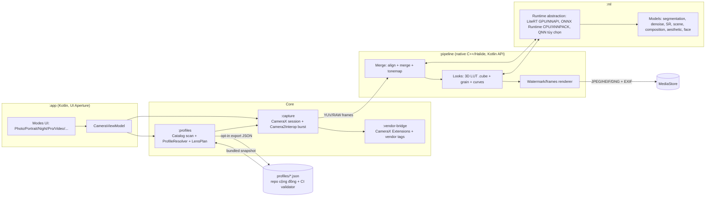

# Aperio: app camera mã nguồn mở (fork Aperture)

## Tổng quan

Fork `LineageOS/android_packages_apps_Aperture` (nhánh `lineage-24.0`, Kotlin, CameraX, Apache-2.0) thành một app camera độc lập, phát hành được trên F-Droid và đưa vào ROM qua Soong. Mọi tính năng của Leica port (`com.kobbin.leica.wmrebuild`), MIUI Camera và GCam được viết lại bằng code riêng. Được phép đọc code dịch ngược (Leica port, MIUI) để lấy ý tưởng và logic, kết hợp kiến thức công khai và model/thư viện có giấy phép dễ dãi. Không chép nguyên văn code, không đóng gói model, bảng LUT, watermark hay nhãn hiệu của Xiaomi, Leica, Google.

Tên đề xuất: **Aperio** (Latin "tôi mở ra"; gần với Aperture, không đụng nhãn hiệu camera). Package `org.aperio.camera`. Cần tra nhãn hiệu trước khi chốt (câu hỏi mở 1). Các "look" kiểu Leica dùng tên trung tính: *Classic CCD* (thay M9), *Classic CCD Plus* (M9+), *Rangefinder Neutral* (M10-R), *Silver Mono* (M3/Monochrom), *Vivid*, *Natural*. Watermark: khung "Film border", "EXIF strip", không logo hãng.

Báo cáo nguồn và giấy phép: `plans/reports/planner-261109-2101-open-camera-app.md`.

Đặc tả chức năng app tham chiếu (lens/profile, looks, hàng đợi nền, composition, runtime AI, Camera2, gap list): [spec-leica-functional.md](spec-leica-functional.md).

## Quyết định đã chốt (2026-11-09)

- **Tên:** người dùng chọn `open-camera` thay cho Aperio. Chưa áp vào các phase file vì tên "Open Camera" đã là một app GPL nổi tiếng trên Play Store và F-Droid (package `net.sourceforge.opencamera`), dễ bị nhầm và F-Droid có thể từ chối. Cần chốt lại tên hiển thị và package trước Phase 1.
- **AI backend:** chỉ CPU/GPU (ONNX Runtime, LiteRT GPU delegate, NNAPI nếu có). Không làm bản QNN của Qualcomm. Một bản duy nhất, lên được F-Droid.
- **Device profile database:** repo riêng, app tải bản mới theo từng đợt phát hành.
- **Ảnh cộng đồng để huấn luyện model:** không nhận. Chỉ dùng model có sẵn với giấy phép mở.

## Mục tiêu

- App chạy trên mọi máy Android 8.0+ (minSdk 26 như Aperture), tối ưu cho gauguin (SM7225, LineageOS 24 / Android 17, SDK 37).
- Đủ các nhóm tính năng: chụp/quay cơ bản, looks + watermark, HDR/Night/Astro/Super Res Zoom đa khung, AI (bokeh, denoise, SR, scene detect, composition, aesthetic score, beauty), video nâng cao, Pro/RAW, cầu nối vendor extension.
- Hệ thống device profile: tự sinh từ Camera2 lúc mở lần đầu, cơ sở dữ liệu cộng đồng, luồng gửi profile, validator trong CI. Seed bằng gauguin.
- Phát hành: F-Droid (reproducible build) và module Soong để ROM tích hợp.

## Không làm

- Không dùng tên/logo Leica, Xiaomi, Hasselblad, Zeiss; không dùng asset, model `.minn`/`.onnx` lấy từ APK Leica port hay MIUI.
- Không lấy mã Open Camera (GPL-3.0) hay bất kỳ mã GPL nào vào app Apache-2.0; chỉ tham khảo danh sách tính năng.
- Không dịch vụ đám mây, không thu thập dữ liệu tự động; mọi gửi profile đều opt-in.
- Không viết HAL hay sửa vendor blob; tính năng cần HAL độc quyền chỉ dùng qua cầu nối khi máy đã mở ra.

## Kiến trúc

Luồng dữ liệu: `CameraManager` characteristics → `:profiles` (catalog + profile khớp) → `LensPlan` (zoom stops, camera id) → `:capture` (preview + burst/ảnh đơn/RAW) → `:pipeline` (merge, AI qua `:ml`, look, watermark) → MediaStore. Xử lý nặng chạy trong `WorkManager` foreground worker có thông báo tiến trình (giống "background rendering" của Leica port) để không mất ảnh khi app bị đóng.

## Ma trận giấy phép (tóm tắt, chi tiết trong báo cáo)

| Thành phần | Giấy phép | Dùng được trong Apache-2.0 |
|---|---|---|
| Aperture | Apache-2.0 (+ BSD-3, CC-PDDC theo REUSE) | Có (gốc fork) |
| CameraX, Camera2, Media3 | Apache-2.0 | Có |
| Halide | MIT | Có |
| OpenCV 4.5+ | Apache-2.0 | Có |
| ONNX Runtime Mobile | MIT | Có |
| LiteRT (TFLite) | Apache-2.0 | Có |
| MediaPipe + model selfie segmentation / face landmarker | Apache-2.0 | Có (kiểm model card từng model) |
| NAFNet | MIT | Có |
| Real-ESRGAN | BSD-3-Clause | Có |
| NIMA (idealo) | Apache-2.0 | Có |
| hdr-plus (timothybrooks, Halide) | cần xác minh | Chỉ tham khảo thuật toán cho tới khi xác minh |
| Zero-DCE / Zero-DCE++ | cần xác minh, có thể chỉ phi thương mại | Không dùng weights cho tới khi xác minh |
| MIRNet | cần xác minh | Không dùng weights cho tới khi xác minh |
| CACNet (composition) | không rõ | Không dùng, tự huấn luyện thay thế |
| Qualcomm QNN/SNPE | độc quyền, có điều khoản phân phối | Không đưa vào bản F-Droid; chỉ flavor riêng tùy chọn |
| Open Camera | GPL-3.0 | Không (chỉ tham khảo tính năng) |
| LibRaw | LGPL-2.1/CDDL | Không cần; dùng `DngCreator` của Android |

## Các phase

| # | Phase | Phụ thuộc | Công sức | File |
|---|---|---|---|---|
| 1 | Fork, đổi tên, build Gradle + Soong, CI | none | 2w | [phase-01-fork-rebrand-build.md](phase-01-fork-rebrand-build.md) |
| 2 | Device profile: schema, tự sinh, DB cộng đồng, validator | 1 | 4w | [phase-02-device-profiles.md](phase-02-device-profiles.md) |
| 3 | Looks (LUT tự làm) + watermark + xử lý nền (MVP release) | 1 | 4w | [phase-03-looks-watermark.md](phase-03-looks-watermark.md) |
| 4 | Đa khung: HDR, Night, Astro, Super Res Zoom | 2, 3 | 8w | [phase-04-multiframe-hdr-night.md](phase-04-multiframe-hdr-night.md) |
| 5 | Runtime AI (CPU/GPU/DSP) + tính năng AI | 3, 4 | 10w | [phase-05-ai-features.md](phase-05-ai-features.md) |
| 6 | Video và các chế độ phụ | 2 | 8w | [phase-06-video-modes.md](phase-06-video-modes.md) |
| 7 | Pro và RAW | 2 | 4w | [phase-07-pro-raw.md](phase-07-pro-raw.md) |
| 8 | Cầu nối vendor extension | 2, 5 | 4w | [phase-08-vendor-bridge.md](phase-08-vendor-bridge.md) |
| 9 | Phân phối: F-Droid, ROM qua Soong, bản dịch | 1, 3 (MVP); mọi phase cho 1.0 | 3w + liên tục | [phase-09-distribution.md](phase-09-distribution.md) |

Tổng khoảng 47 tuần-người cho một người làm chính, cộng 5 tuần dự phòng (52w). Phase 6 và 7 chạy song song với 4/5 nếu có người thứ hai (ranh giới module tách biệt, xem bảng sở hữu file trong từng phase).

Mốc phát hành: **0.1 MVP** = phase 1+2+3; **0.3** = +4; **0.5** = +5; **0.7** = +6+7; **1.0** = +8+9 hoàn chỉnh.

## Tiêu chí nghiệm thu chung

- `./gradlew assembleRelease lint test` xanh; `m Aperio` trong cây LineageOS 24 dựng được.
- REUSE lint xanh (`reuse lint`), mọi file và model có SPDX; `licenses/models.md` liệt kê nguồn, giấy phép, hash từng model.
- Trên gauguin: chip 0.6x/1x/2x đúng camera id 3/0/0 (crop) như kết quả Leica port; không ANR khi đổi ống lần đầu (StrictMode + `adb shell dumpsys activity anr` sạch).
- Mỗi tính năng có đường lùi khi phần cứng thiếu; ma trận thiết bị kiểm thử: gauguin (SM7225), một máy Pixel, một máy MediaTek, một máy Exynos hoặc emulator CameraX.

## Rủi ro chính

| Rủi ro | Khả năng x Tác động | Giảm thiểu |
|---|---|---|
| Nhiễm mã/asset độc quyền (vô tình chép từ jadx Leica/MIUI) | Trung bình x Cao | Được đọc `miui-ports/leica/jadx-*` để lấy logic nhưng tự viết code theo cấu trúc riêng; không chép nguyên văn code, không mang model/LUT/asset của họ vào repo; PR template có checkbox nguồn gốc (model/LUT tự tạo hoặc giấy phép mở) |
| Model có giấy phép phi thương mại | Cao x Cao | Chỉ dùng model trong danh sách trắng của báo cáo; còn lại tự huấn luyện trên dataset giấy phép mở |
| Hiệu năng đa khung/AI trên SM7225 (chỉ GPU Adreno 619, DSP cũ) | Cao x Trung bình | Ngân sách thời gian mỗi tính năng, model nhỏ, xử lý nền, LiteRT GPU delegate trước, QNN tùy chọn |
| Camera2 khác nhau giữa hãng (logical camera, id ẩn) | Cao x Trung bình | Profile + quirks, đường lùi về CameraX mặc định |
| F-Droid từ chối blob (QNN, Play Services) | Trung bình x Trung bình | Flavor `foss` không có blob; flavor `qnn` phát hành riêng |

## Rollback

Mỗi phase là một nhánh và một bộ module riêng, gắn feature flag trong `PreferencesRepository`; tắt flag là quay về hành vi Aperture gốc. Upstream Aperture được merge định kỳ qua remote `upstream`.

## Câu hỏi chưa giải quyết

1. Chốt tên Aperio và package `org.aperio.camera`? Cần tra nhãn hiệu (EUIPO/USPTO) và trùng tên trên F-Droid/Play.
2. Có muốn phát hành flavor `qnn` (blob Qualcomm) không, hay chỉ CPU/GPU/NNAPI?
3. Repo profile cộng đồng tách riêng (`aperio-device-profiles`) hay nằm chung repo app?
4. Có nhận dữ liệu ảnh cộng đồng để huấn luyện model composition/scene không (vấn đề quyền riêng tư và giấy phép dữ liệu)?
